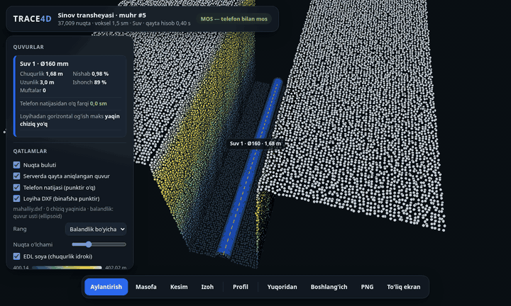
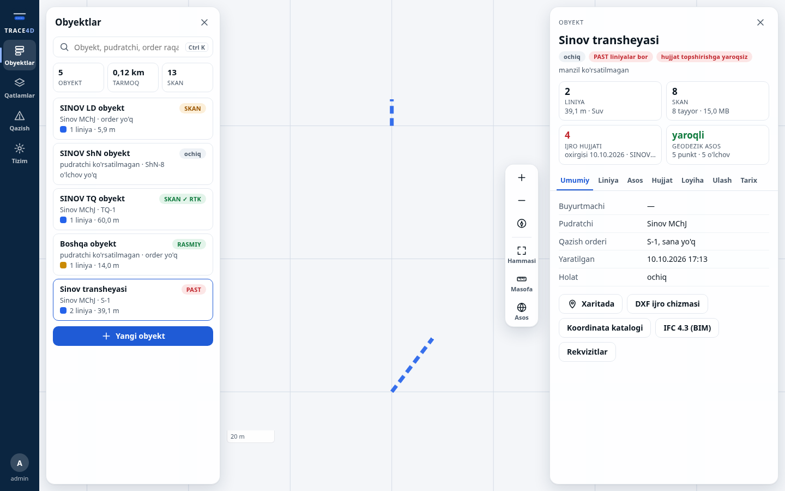
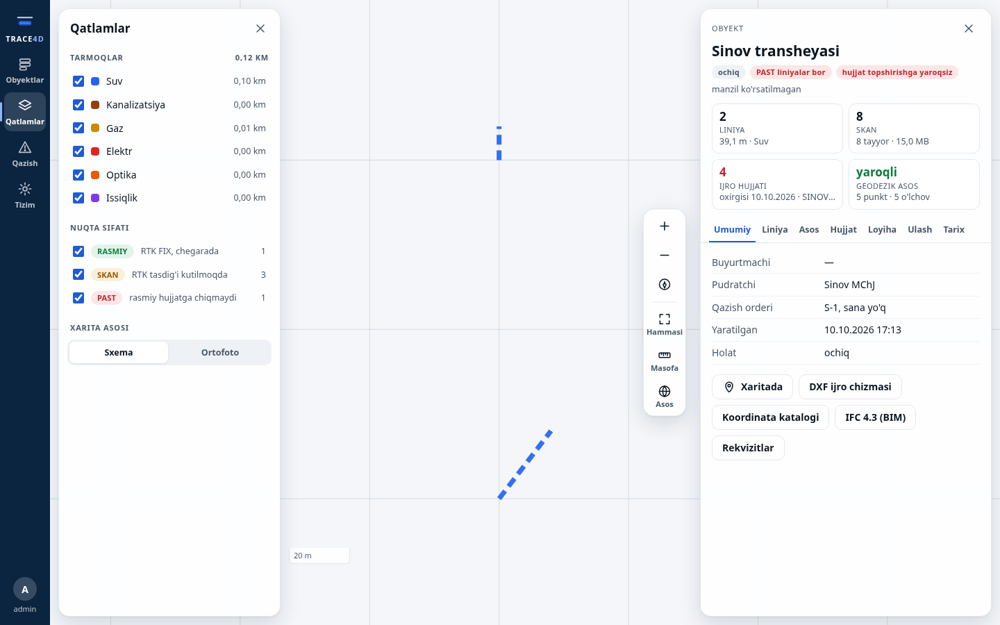
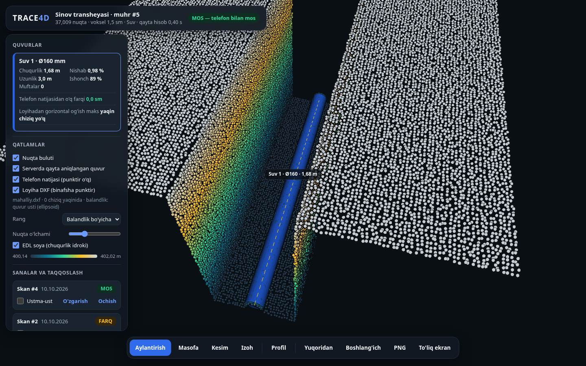
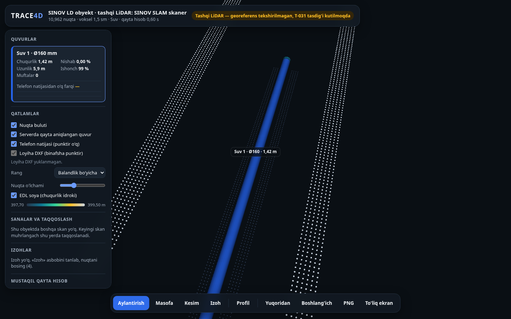
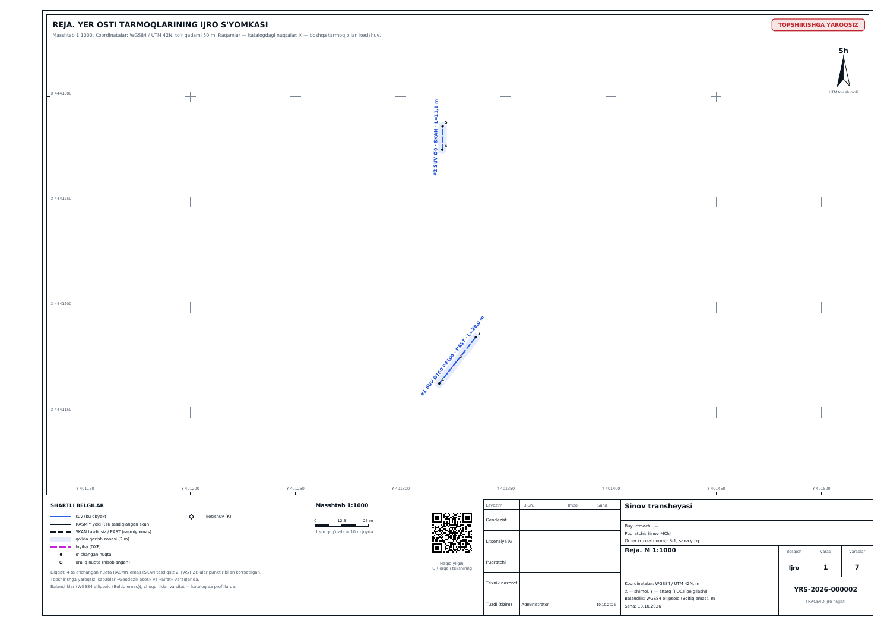
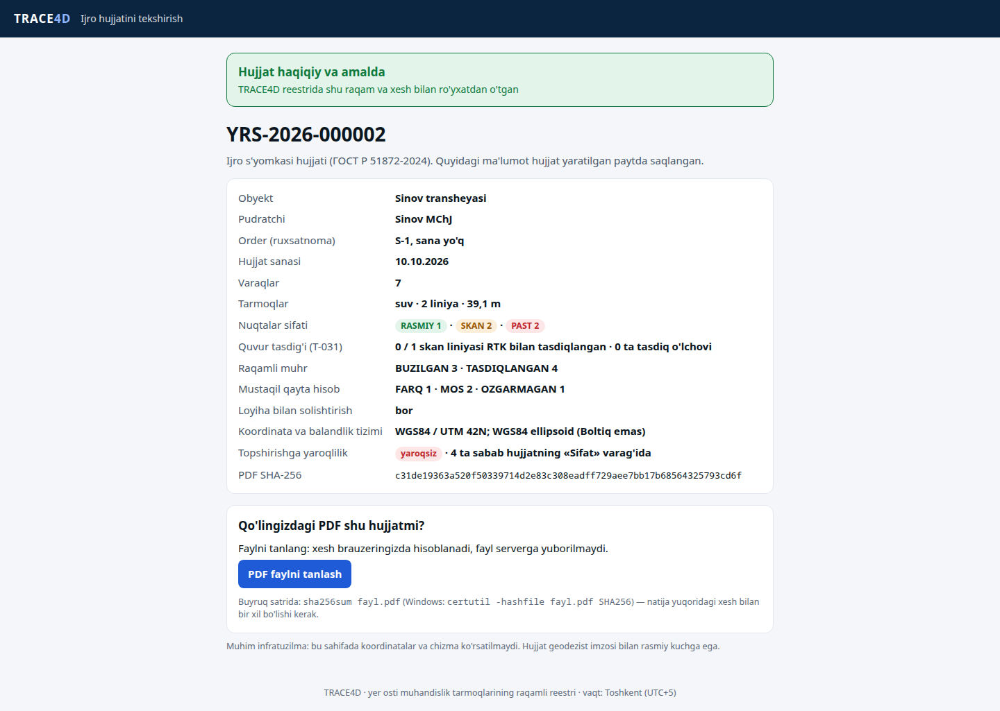
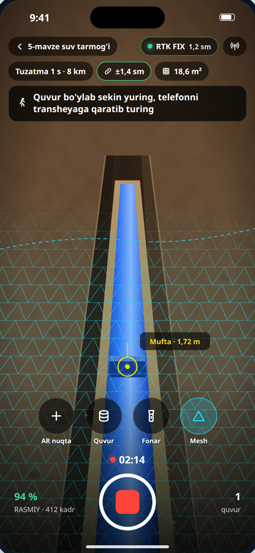
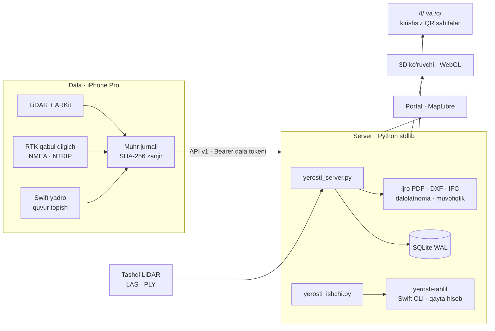

<div align="center">



**Yer osti muhandislik tarmoqlarining raqamli reestri:** ochiq transheya telefon LiDAR'i va RTK bilan skanerlanadi, server nuqtalar bulutidan quvurni mustaqil qayta aniqlaydi, natija 3D'da ko'rinadi va QR bilan tekshiriladigan ijro hujjati (PDF, DXF, IFC) bo'lib chiqadi.


-3776AB?logo=python&logoColor=white)


</div>

---

## 3D ko'ruvchi (TRACE4D View)

<div align="center">

</div>

Transheya nuqtalar buluti balandlik bo'yicha bo'yaladi, serverda **qayta aniqlangan** quvur silindr bo'lib, telefon natijasi punktir o'q bo'lib ustma-ust ko'rsatiladi. Ikkalasi orasidagi o'q farqi, chuqurlik, nishab va ishonch paneldagi kartada; masofa, kesim, profil va izoh asboblari bor.

## Asosiy imkoniyatlar

| | |
|---|---|
| 📱 **Dala (TRACE4D Scan)** | iPhone Pro LiDAR + ARKit sahna, tashqi RTK qabul qilgich (NMEA/RTCM3, NTRIP), ekranda doim RTK holati va aniqlik; har kadr, RTK nuqta va mesh xeshi **muhr jurnaliga** (SHA-256 zanjir) yoziladi |
| 🧮 **Swift yadro** | Geometriya va UTM, georeferens (bo'lakli — ARKit suzishini tuzatadi), kechikish bahosi, zich bulut, quvur topish (RANSAC + Hough, fizik cheklovlar), M3C2 o'zgarish tahlili. Bir xil kod telefonda va serverda (Linux CLI `yerosti-tahlil`) |
| 🔁 **Mustaqil qayta hisob** | Server telefon yuborgan xom jurnal va bulutdan quvurni qaytadan topadi va telefon natijasi bilan solishtiradi: **MOS / FARQ / O'ZGARMAGAN** |
| 🎯 **Nuqta sifati** | RASMIY (RTK FIX, chegarada) · SKAN (RTK tasdig'i kutilmoqda) · PAST. Skan liniyasi quvur ustida RTK vexa bilan tasdiqlanmaguncha rasmiy hujjatga chiqmaydi |
| 📐 **Lokalizatsiya** | Nazorat punktlari bo'yicha mahalliy tizimga o'tkazish (≥ 4 punkt, qoldiq va LOO tekshiruvi), Emlid CSV importi |
| 📄 **Ijro hujjati** | A3 PDF: reja, koordinata katalogi, profil, sifat varag'i; har varaqda «topshirishga yaroqli / yaroqsiz» va sabablari; QR bilan haqiqiyligini tekshirish sahifasi (`/t/`), PDF xeshi brauzerda solishtiriladi |
| 🧱 **Eksport** | DXF ijro chizmasi, IFC 4.3 (BIM), koordinata katalogi, yopiq ishlar dalolatnomasi, loyiha–ijro muvofiqligi hisoboti |
| 🛰️ **Tashqi LiDAR** | LAS 1.2–1.4 / PLY bulutlarini qabul qiladi va o'sha quvur topish zanjiridan o'tkazadi (natija SKAN — tasdiq talab qilinadi) |
| 🗺️ **Portal (TRACE4D Cloud)** | Xarita birinchi: obyektlar, qatlamlar (6 tarmoq turi), qazish oldidan tekshiruv, inspektor; ortofoto MBTiles yoki to'liq oflayn sxema; rollar, dala tokenlari, ulashish havolalari |
| 🏷️ **QR-belgi** | Quduq va tarmoq plastinkalari uchun QR (`/q/`): kirishsiz qisqa ma'lumot, bekor qilingan belgi ogohlantirishi |

## Ekranlar

<table>
<tr>
<td width="50%"><br/><sub><b>Portal</b> — obyektlar ro'yxati, xarita va inspektor (liniya, skan, ijro hujjati, geodezik asos)</sub></td>
<td width="50%"><br/><sub><b>Qatlamlar</b> — tarmoq turlari, nuqta sifati, xarita asosi</sub></td>
</tr>
<tr>
<td><br/><sub><b>3D</b> — qayta aniqlangan Ø160 quvur, telefon bilan «MOS», sanalar bo'yicha taqqoslash</sub></td>
<td><br/><sub><b>Tashqi LiDAR</b> — import qilingan bulut, «tasdiq kutilmoqda» ogohlantirishi</sub></td>
</tr>
<tr>
<td><br/><sub><b>Ijro hujjati (PDF, A3)</b> — reja varag'i, shartli belgilar, QR va shtamp</sub></td>
<td><br/><sub><b>QR tekshirish</b> — hujjat reestrda borligi, sifat xulosasi va SHA-256</sub></td>
</tr>
<tr>
<td><br/><sub><b>iPhone ilova maketi</b> — skan ekrani dizayni</sub></td>
<td></td>
</tr>
</table>

> Portal, 3D va hujjat suratlari server sinovi (`sinov/server_sinov.py`) yaratgan **sun'iy** ma'lumotdan olingan: obyektlar «Sinov transheyasi», «Sinov MChJ», geometriya va skanlar simulyatsiya. iPhone rasmi — dizayn maketi (iOS ilova kodi bor, lekin qurilmada hali yig'ilmagan).

## Arxitektura



- **Bitta yadro, ikki joyda:** quvur topish va geometriya Swift paketida; telefon ham, server ham shu kodni ishlatadi, natijalar bayt darajasida solishtiriladi.
- **Joylash:** Docker ko'p bosqichli tasvir (Swift yig'ish → ish → sinov bosqichi), umumiy Caddy ortida, host porti ochilmaydi; kunlik zaxira; ma'lumot markazida to'liq oflayn ishlashi mumkin (`YEROSTI_XARITA_USLUB=yoq`).

## Sifat

Barcha raqamlar shu repo nusxasida ishga tushirib sanalgan:

| To'plam | Buyruq | Natija |
|---|---|---|
| Swift yadro | `cd Yadro && swift test` | **137 o'tdi**, 3 atayin o'tkazib yuborildi (sinov to'plamini yozuvchi va o'lchov rejimlari) |
| Server, uchma-uch | `python3 sinov/server_sinov.py` | **182** tekshiruv, 0 xato |
| Ijro hujjati | `python3 sinov/ijro_sinov.py` | **75** |
| Lokalizatsiya | `python3 sinov/lokal_sinov.py` | **28** |
| Quvur tasdig'i | `python3 sinov/tasdiq_sinov.py` | **18** |
| Tashqi LiDAR | `python3 sinov/las_sinov.py` | **16** |
| Zaxira | `python3 sinov/zaxira_sinov.py` | **15** |

Server sinovining bir qismi release CLI (`swift build -c release --product yerosti-tahlil`) va xom sinov to'plamini talab qiladi; to'plam (8,6 MB) repoga kiritilmagan, uni yadro sinovi yaratadi: `SINOV_TOPLAM_XOM=../sinov/toplam_xom swift test --filter testXomToplamniYoz`.

## Ishga tushirish

```bash
# Swift yadro va CLI (Swift 6.x, Linux yoki macOS)
cd Yadro && swift test && swift build -c release --product yerosti-tahlil && cd ..

# Server (Python 3.12+, PDF uchun reportlab va qrcode)
pip install reportlab qrcode pillow
cp .env.example .env
python3 yerosti_server.py --port 8342       # http://127.0.0.1:8342 · admin paroli jurnalda bir marta chiqadi

# Docker
docker compose up -d --build
```

iOS ilova: `Ilova/` (SwiftPM + xtool, `Ilova/YIGISH.md`). Dala ishi bo'yicha qo'llanma — `DALA_YORIQNOMA.md`, serverga joylash — `JOYLASH.md` va `ornatish/server/`.

## Texnologiyalar

Swift 6.4 (SwiftPM, XCTest) · ARKit · SwiftUI · Python 3 (standart kutubxona) · SQLite WAL · ReportLab · qrcode · MapLibre GL (oflayn, CSP) · WebGL 3D · IFC 4.3 · DXF · LAS / PLY · MBTiles · Docker · Caddy

## Jonli

🌐 **https://trace4d.geonazorat.uz** (kirish login bilan)

---

<div align="center">

**Manba kodi ochiq.** Savol va hamkorlik bo'yicha: Telegram [@Humoyun_Davronov](https://t.me/Humoyun_Davronov)

<sub>Muallif — Humoyun Davronov</sub>

</div>
